<p align="center">
  
</p>

<p align="center">
  <b>Computer Science student · Full-stack web development · Applied AI</b><br />
  From an idea to an interface, an API, and a working project.
</p>

<p align="center">
  <a href="https://www.linkedin.com/in/shlok-maurya-31b889333/"></a>
  <a href="https://leetcode.com/hereshlok/"></a>
  <a href="mailto:pranshmaurya.810@gmail.com"></a>
  <a href="https://github.com/codewithshlok334?tab=repositories"></a>
</p>

---

### 🖥️ About the developer

```yaml
name: Shlok Maurya
handle: codewithshlok334
education: B.Tech in Computer Science / IT — AKTU
focus: Full-stack web apps, AI integrations, and practical problem-solving
building: SkillNex · MuleEngine · PayGuard
open_to: Internships, learning together, and project collaborations
```

I enjoy connecting useful interfaces with the logic behind them. My projects span career tools, transaction analysis, payment screenshot screening, and student-focused web apps. I'm building my skills in **React, TypeScript, Python, and Java**, one project at a time.

### 🚀 Featured projects

<table>
  <tr>
    <td width="50%" valign="top">
      <h3>01 · SkillNex</h3>
      <p>A career and campus platform with resume tools, interview practice, coding exercises, and AI-assisted guidance.</p>
      <p><code>React</code> <code>TypeScript</code> <code>Spring Boot</code> <code>PostgreSQL</code></p>
      <a href="https://github.com/codewithshlok334/Skillnex"><b>Explore SkillNex →</b></a>
    </td>
    <td width="50%" valign="top">
      <h3>02 · MuleEngine</h3>
      <p>A graph-based transaction analysis project for exploring suspicious money-mule patterns, with a visual dashboard and a Python API.</p>
      <p><code>React</code> <code>FastAPI</code> <code>NetworkX</code> <code>Python</code></p>
      <a href="https://github.com/codewithshlok334/MuleEngine"><b>Explore MuleEngine →</b></a>
    </td>
  </tr>
  <tr>
    <td width="50%" valign="top">
      <h3>03 · PayGuard</h3>
      <p>A payment screenshot screening prototype using Error Level Analysis and reference-number heuristics to flag possible manipulation.</p>
      <p><code>Python</code> <code>FastAPI</code> <code>Pillow</code> <code>JavaScript</code></p>
      <a href="https://github.com/codewithshlok334/PayGaurd--Fake-payment_detector"><b>Explore PayGuard →</b></a>
    </td>
    <td width="50%" valign="top">
      <h3>04 · Gram Sahayak</h3>
      <p>A team project exploring a low-bandwidth AI assistant for rural communities. My role: team lead, idea development, testing, and debugging.</p>
      <p><code>AI assistant</code> <code>Web</code> <code>Team project</code></p>
      <a href="https://github.com/codewithshlok334/A-S3-Innovators_GramSahayak"><b>Explore Gram Sahayak →</b></a>
    </td>
  </tr>
</table>

**More to explore:** [College Exchange](https://github.com/codewithshlok334/college-exchange) · [Portfolio source](https://github.com/codewithshlok334/portfolio) · [All repositories](https://github.com/codewithshlok334?tab=repositories)

### 🛠️ Technologies in my projects

**Frontend**

<p>
  
  
  
  
  
  
</p>

**Backend & data**

<p>
  
  
  
  
  
</p>

**Tools & exploration**

<p>
  
  
  
  
  
</p>

### 🌱 What I'm working on

- Connecting frontend experiences with clear, dependable backend APIs.
- Exploring AI features for career guidance and practical analysis tools.
- Improving data structures and algorithms through [LeetCode practice](https://leetcode.com/hereshlok/).
- Making my projects easier to understand, test, and run.

<details>
<summary><b>🧠 Developer blueprint</b></summary>

```python
class ShlokMaurya:
    def __init__(self):
        self.languages = ["Python", "Java", "JavaScript", "TypeScript"]
        self.interests = ["Web development", "Applied AI", "Problem-solving"]
        self.projects = ["SkillNex", "MuleEngine", "PayGuard"]

    def build(self, idea):
        return f"Understand {idea}. Build it. Test it. Improve it."
```

</details>

### 🤝 Let's connect

I'm open to internship opportunities and collaborating on useful web and AI projects.

**[LinkedIn](https://www.linkedin.com/in/shlok-maurya-31b889333/)** · **[LeetCode](https://leetcode.com/hereshlok/)** · **[Email](mailto:pranshmaurya.810@gmail.com)**

<p align="center">
  
</p>
